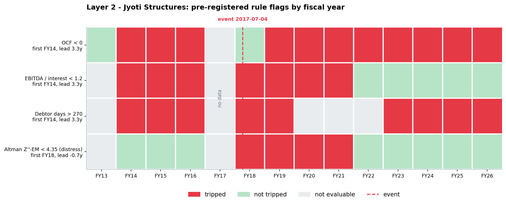
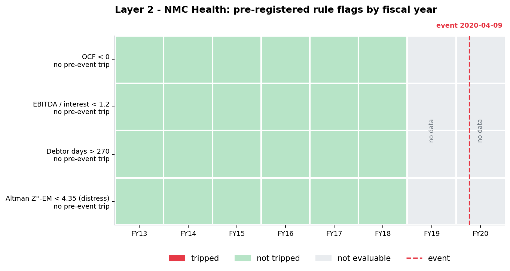
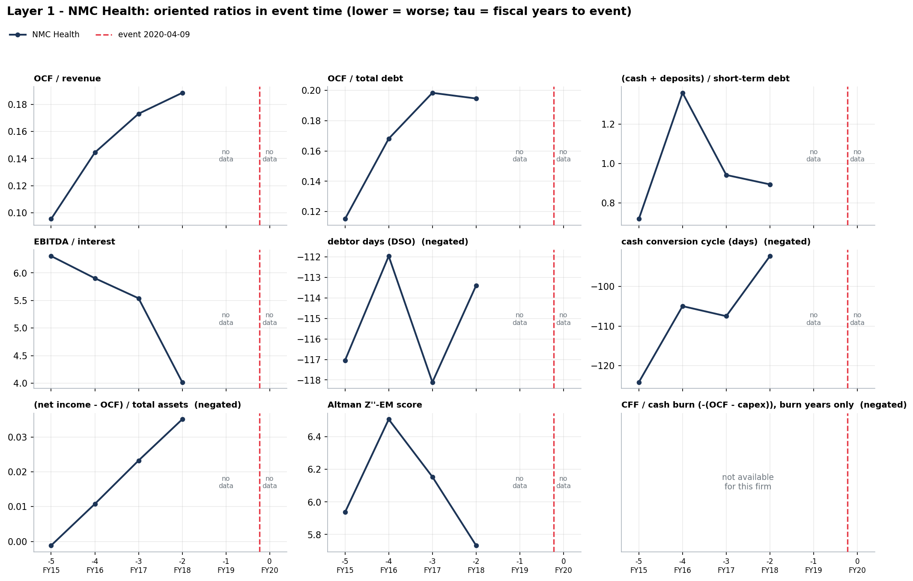
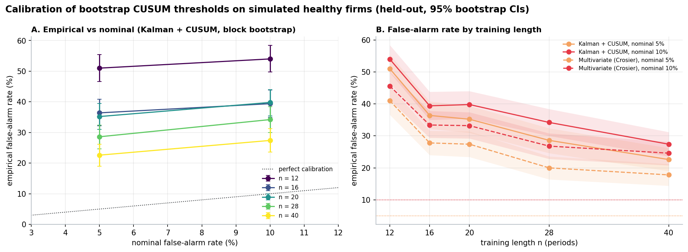
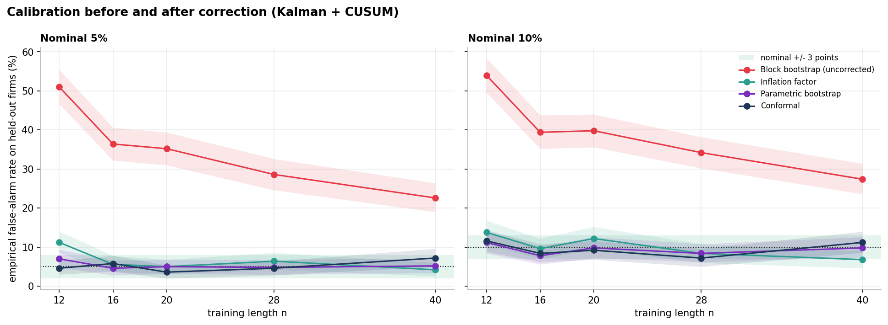
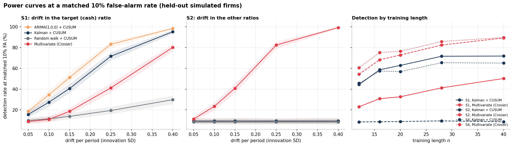
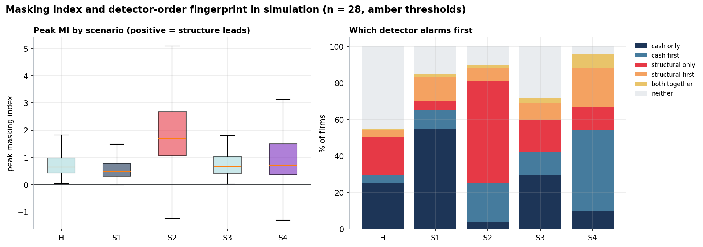
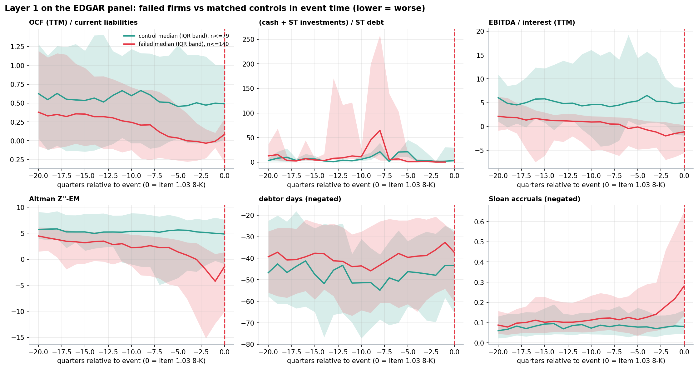
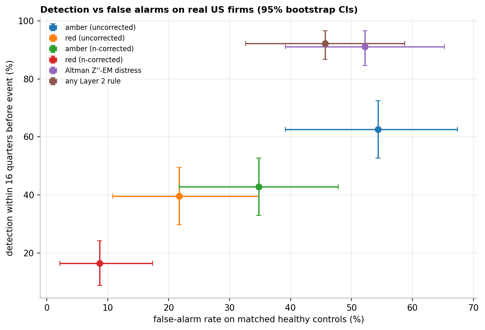
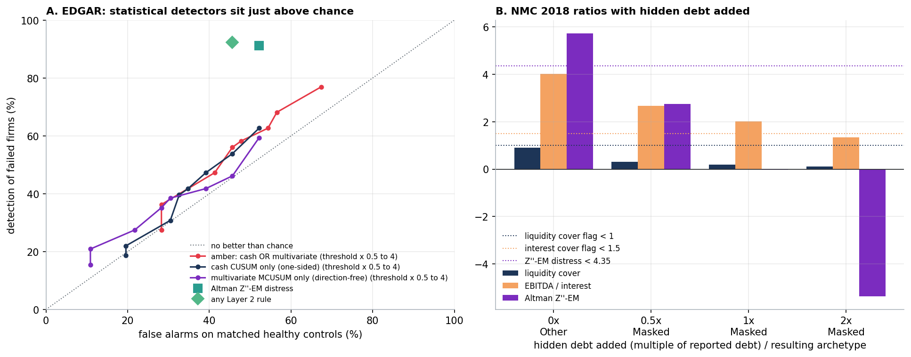

# Judging a firm against its own history

*A layered early-warning framework, a measurement and correction of small-sample threshold miscalibration, and a test of when cash flow warns versus hides distress.*

Foundations of Data Science course project · generated from `reports/tables/` by `src/reporting/write_report.py` · pre-registration dated 2026-11-21

## Abstract

Distress models usually need large panels of failed firms and peers. We instead monitor each firm against its own ratio history: a local-level state-space model turns each ratio into standardised forecast errors, and a CUSUM accumulates persistent deterioration. **Headline result: the standard block-bootstrap calibration of CUSUM alarm thresholds is badly over-liberal with short histories.** On 500 simulated healthy firms per cell trained on 28 periods, thresholds set for a 10% false-alarm rate produced 34.2% (95% CI 30.0%–38.4%); thresholds set for 5% produced 28.6%. Three cheap corrections, fitted on separate simulated firms, bring the held-out rate to 8.4% (inflation factor), 7.2% (conformal) and 8.4% (parametric bootstrap), at very different costs in detection. A multivariate detector loses to the univariate one when the drift sits in the cash ratio but wins clearly when cash is healthy or concealed. In the two case studies cash flow warned early at Jyoti Structures (operating cash flow negative from FY2014) and stayed silent at NMC Health, where only liquidity cover of short-term debt fell below 1. On an exploratory panel of 91 US bankruptcies with 46 matched controls from SEC EDGAR, simple pre-set rules beat both the statistical detectors and Altman Z'' on expected cost, and the amber statistical tier did not reliably separate failed from healthy firms (detection 62.6% vs false alarms 54.3%); a post-hoc diagnosis points to the model absorbing slow declines and to failed firms being weak for years rather than suddenly worse. Pre-registered hypotheses H2–H5 are supported; H1 and H6 cannot be tested on the data collected so far.

## 1. Introduction

Lenders, auditors and regulators often monitor firms with short histories and no comparable peers, which is common for mid-caps in India and the Gulf. Cross-sectional failure models (Altman, Ohlson, hazard models, classifiers) need many failures to estimate. This project asks a narrower question that a single firm's data can answer: **when does a firm's own cash-flow history warn early, and when does it hide the problem?**

Six research questions were fixed, with explicit 'supported if / refuted if' criteria, before any detector was run (`docs/PREREGISTRATION.md`; SHA-256 fingerprint in `docs/PREREG_FINGERPRINT.txt`):

| ID | Hypothesis (abridged) | Verdict |
|---|---|---|
| H1 | Jyoti: univariate state-space + CUSUM alarms ≥ 2 fiscal years before insolvency | **INCONCLUSIVE** |
| H2 | NMC: cash flags silent through 2018 while structural flags trip ≥ 1 year earlier | **SUPPORTED** |
| H3 | Multivariate detector wins when the target is masked, loses slightly when drift is in the target | **SUPPORTED** |
| H4 | Bootstrap thresholds are over-liberal at about 28 training periods | **SUPPORTED** |
| H5 | An inflation factor or conformal threshold brings false alarms within ±3 points of nominal at n = 28 | **SUPPORTED** |
| H6 | Cohort: masked firms have higher peak masking index and the multivariate detector alarms first | **INCONCLUSIVE** |

**Contributions.** (1) *Method*: a layered framework running a cash-first univariate detector and a multivariate detector side by side over a rule benchmark. (2) *Measurement*: a calibration curve quantifying how far bootstrap CUSUM thresholds miss their nominal false-alarm rate at small n, with three tested corrections and their cost. (3) *Typology*: a masking index and detector-order fingerprint, validated in simulation.

## 2. Related work

Ratio-based failure prediction starts with Beaver (1966) and Altman's Z-score (1968), extended to non-manufacturing and emerging-market firms as Z''-EM (Altman, Hartzell & Peck 1995; Altman 2005); Ohlson (1980) and Shumway (2001) moved to logit and hazard models. Cash-flow-based warning is studied by Largay & Stickney (1980) on W.T. Grant and Casey & Bartczak (1985); earnings quality by Sloan (1996) and Beneish (1999). The monitoring tools are Page's CUSUM (1954), Crosier's multivariate CUSUM (1988), Ledoit–Wolf shrinkage (2004), block bootstraps (Künsch 1989; Politis & Romano 1994), state-space methods (Durbin & Koopman 2012), conformal prediction (Vovk, Gammerman & Shafer 2005; Angelopoulos & Bates 2023), and the effect of estimated parameters on control charts (Jensen et al. 2006). Full references are at the end. No systematic literature search was done; the framework is a distinctive combination for a course project, not a claim of novelty.

## 3. Data and audit

**Deep cases.** NMC Health: annual, 2013–2018, US$ thousands, as originally reported [verify: original NMC source documents (LSE RNS results)]. Jyoti Structures: annual, FY2013–FY2026, INR crore, consolidated, from Screener.in (vendor-standardised). Event dates, checked against primary records: NMC Health PLC was placed into administration by the English High Court on 2020-04-09 on Abu Dhabi Commercial Bank's application (the ADGM court followed for the UAE operating companies on 2020-09-27); Jyoti Structures was admitted to the corporate insolvency resolution process by NCLT Mumbai on 2017-07-04 (CP 1137/I&BP/2017).

**Audit decisions** (full list: `docs/decision_log.md`):
- Accounting identities (assets = liabilities + equity; EBITDA + other income − interest − depreciation = PBT; DSO + DIO − DPO = CCC) are checked before any analysis and stop the run on failure, naming firm, year and columns.
- Jyoti FY2017 is not published on Screener: kept missing, never interpolated.
- Jyoti FY2018 operating cash flow of +1,190 on sales of 324 is flagged as an anomaly, not dropped.
- Ratios with near-zero denominators are masked (|denominator| ≤ ε × total assets; ε = 1% for revenue-based ratios, 0.1% otherwise). Example: Jyoti FY2022 debtor days of 158,009 on sales of 4 become missing.
- Screener lacks a current/non-current split, so Jyoti's working capital and current liabilities are proxies that overstate Altman's X1.
- A public panel of about 9,000 US firms was rejected earlier because basic identities failed in most rows (blueprint §4.3).

**EDGAR panel (exploratory).** The deep cases cannot support Layers 3–5, and the India/GCC cohort has not been collected yet, so the method was also run on US firms. Event = first 8-K citing Item 1.03 (bankruptcy) in 2015–2023, financials excluded. Of 150 failed firms in the panel and 87 size- and industry-matched controls, 91 failed firms and 46 paired controls had enough quarterly XBRL history (≥ 12 usable training quarters before a 16-quarter monitored window). Year-to-date figures were de-cumulated into quarters, flows taken as trailing-twelve-month sums, and the first-filed value kept (`reports/tables/edgar_funnel.csv`). These rules were written to the config before download.

## 4. What the EDA taught

Jyoti's cash flow broke first: the Layer 2 rule 'OCF < 0' first tripped in FY2014, a lead of 3.26 years over the insolvency admission, while net worth only turned negative in FY2016. NMC is the opposite: no cash rule tripped in any year, but liquidity cover ((cash + deposits) / short-term debt) was below 1 in FY2015, FY2017, FY2018, falling to 0.89 in 2018 (`reports/tables/ratios_nmc.csv`). These two patterns motivated a cash-first detector plus a structural detector.

*Figure 1. Jyoti Structures: pre-registered rule flags by fiscal year. Notice that three rules trip from FY14, three years before the event, while Altman Z''-EM only enters distress after it.*

*Figure 2. NMC Health: no pre-registered rule ever trips; the only warning in the data is the liquidity cover in Figure 3.*

*Figure 3. NMC in event time (lower = worse). Cash ratios improve into the event; liquidity cover and interest cover deteriorate.*

## 5. Method

All ratios are oriented so that lower is worse. **Layer 0** builds and audits ratios. **Layer 1** aligns firms in event time. **Layer 2** applies pre-set rules (OCF < 0; EBITDA/interest < 1.2; debtor days > 270; Altman Z''-EM < 4.35). **Layer 3** fits a local level + AR(1) model on the training window, filters the whole series with frozen parameters and monitors standardised one-step errors z_t with a one-sided CUSUM:

  S_t = max(0, S_{t−1} − z_t − k),  k = 0.5,  alarm when S_t > h.

**Layer 4** runs the same model on several ratios, estimates the innovation covariance Σ with Ledoit–Wolf shrinkage, and monitors Crosier's MCUSUM:

  C_t = √((S_{t−1}+z_t)ᵀ Σ⁻¹ (S_{t−1}+z_t)),  S_t = 0 if C_t ≤ k, else (S_{t−1}+z_t)(1 − k/C_t).

**Layer 5** sets h by circular block bootstrap of pseudo-out-of-sample innovations (refit on the first 60% of training, filter the rest, centre, 2000 resamples, block length ⌈n^(1/3)⌉, h = (1 − α) quantile of the maximum CUSUM over a 16-period path). Amber fires when either detector passes its 10% threshold; red when the multivariate detector passes its 5% threshold and a Layer 2 rule agrees. **Layer 6** computes the masking index MI_t = S_struct,t / h_struct − S_cash,t / h_cash and records which detector alarms first.

## 6. Simulation and calibration study

Synthetic firms have 4 AR(1) ratios (φ = 0.5, innovation correlation 0.3), 16 monitored periods, and a known onset. Scenarios: S1 drift in the cash ratio; S2 cash healthy, other ratios deteriorating; S3 small drift everywhere; S4 concealment (all ratios deteriorate but the reported cash ratio is exponentially smoothed, s = 0.3). 500 held-out firms per training length; corrections were fitted on a separate 500 per cell with a different seed. 0 firm-runs failed. *The simulation validates the method under assumed dynamics; it is not evidence about real firms.*

**6.1 Calibration curve (H4).** The empirical false-alarm rate is far above nominal at every training length: 54.0% at n = 12 and still 27.4% at n = 40 for a 10% target; at n = 28, 34.2% (30.0%–38.4%), in line with what the blueprint reported from earlier scripts. **H4: SUPPORTED.**

*Figure 4. Every point sits far above the diagonal; more training data helps but does not close the gap.*

**6.2 Corrections (H5).** At n = 28 and a 10% target, on held-out firms:

| Method | False-alarm rate (95% CI) | Detection in S1 | Detection lost (points) |
|---|---|---|---|
| Block bootstrap (uncorrected) | 34.2% (30.2%–38.2%) | 68.0% | 0.0 |
| Inflation factor | 8.4% (6.0%–10.8%) | 43.6% | 24.4 |
| Conformal | 7.2% (5.0%–9.6%) | 65.6% | 2.4 |
| Parametric bootstrap | 8.4% (6.2%–10.8%) | 66.4% | 1.6 |

The required inflation of h at n = 28 was 2.50× (fitted curve log c = 0.405 + 14.63/n). **H5: SUPPORTED**: both pre-registered fixes land within ±3 points. The fixes are not equal, though: a single multiplicative inflation of each firm's own bootstrap threshold also inflates its noise and costs far more detection than the conformal or parametric thresholds. The parametric bootstrap with refitting (200 refits per firm, a logged deviation from 2,000) is the best trade-off here; the conformal threshold needs exchangeable calibration firms, which a real single-firm monitor does not have. At a 5% target the corrected rates were 6.4%, 4.6% and 4.8%.

*Figure 5. After correction all three methods sit in or near the ±3-point band across training lengths; the uncorrected calibrator never does.*

**6.3 Matched false-alarm comparison (H3).** Each detector was tuned to the same empirical 10% false-alarm rate on held-out healthy firms before comparing detection:

| Scenario | ARIMA + CUSUM | Kalman + CUSUM | Random walk + CUSUM | Multivariate |
|---|---|---|---|---|
| S1 | 83.2% | 71.6% | 19.4% | 41.2% |
| S2 | 9.2% | 9.4% | 8.4% | 82.4% |
| S3 | 34.6% | 27.4% | 11.4% | 25.2% |
| S4 | 79.8% | 65.4% | 60.4% | 85.8% |

**H3: SUPPORTED** (matched 10% FA, n=28, multivariate minus Kalman detection: S1 -30.4 pts, S2 +73.0 pts, S4 +20.4 pts). One caveat: S1 loss is not 'slight', and ARIMA beat the Kalman detector in S1 and S4, as in the blueprint's earlier run, so the state-space model's advantage is robustness to missing data and level shifts, not raw power under these dynamics.

*Figure 6. Univariate detectors dominate when drift is in the cash ratio; only the multivariate detector sees S2. Detection rises with training length.*

## 7. Masking index and typology

Peak masking index separates S1 (visible) from S2 with Cohen's d = 1.32 (1.20–1.45) and AUC = 0.89 (0.88–0.91), and from S4 (concealment) more weakly: d = 0.56 (0.49–0.64), AUC = 0.64. Median peak MI was 0.49 in S1, 1.71 in S2 and 0.73 in S4. The fingerprint is more informative than the score: the cash detector alarmed alone in 55% of S1 firms, the structural detector alone in 56% of S2 firms, while under concealment the cash detector still usually fired, just late (cash first 45%, structural first 21%). Healthy firms show 'neither' in only 45%, a direct consequence of the uncorrected thresholds used for MI; MI should be recomputed with corrected thresholds before use.

*Figure 7. MI is highest when structure deteriorates under a quiet cash ratio (S2).*

**Pre-registered archetypes.** By rule, Jyoti is **Visible** (3 consecutive years of negative OCF) and NMC is **Other**, not Masked: its OCF stayed positive but only 1 of the three structural flags (liquidity cover) ever tripped. The blueprint's description of NMC as 'masked' is therefore not confirmed by its own pre-set rule on the annual data.

## 8. Case, cohort and EDGAR results

- **H1 (Jyoti): INCONCLUSIVE.** Layer 3 not run for Jyoti: only 0 usable ocf_to_current_liabilities value(s) in the training window (FY<= 2013); need >= 12. Requires higher-frequency pre-FY14 data (BSE quarterly FY2010-13).
- **H2 (NMC): SUPPORTED.** cash flag (OCF < 0) silent FY2013-FY2018; structural flags tripped: liquidity cover < 1 first FY2015. Never tripped: EBITDA / interest < 1.5; Z''-EM < 4.35. This rests on one ratio crossing a threshold of 1, so it is an illustration, not proof.
- **H6 (cohort): INCONCLUSIVE.** cohort of 6 failed firms collected (Other 3, Visible 3), but the masking index needs Layers 3-4, which run only with >= 12 usable periods; the most any failed firm has is 7 usable annual training values before its monitored window. Rule-level exploratory analogue in cohort_archetype_flag_order.csv.

**The cohort (India).** Built from RBI's 2017 large-defaulter lists by the pre-registered rule, before any figure was read (`data/raw/cohort/PROPOSAL.md`, fingerprinted in `docs/PREREG_FINGERPRINT.txt`): 6 listed failed firms with ≥ 8 pre-event annual filings, 5 controls matched mechanically on Screener industry and total assets (0.5–2×), and 1 negative control. Videocon Industries has no control: no firm in its industry was within the size band. Data: Screener.in public pages (the parser reproduces the hand-transcribed Jyoti data exactly); periods longer or shorter than 12 months (two firms changed their year-end) have flows scaled to 12 months. GCC firms could not be included (no machine-readable source).

| Firm | Role | Event FY | Archetype | Flags in the window | First cash flag | First structural flag | Order |
|---|---|---|---|---|---|---|---|
| Amtek Auto | failed | FY2018 | Other | FY2013-2017 | none | FY2015 | structural only |
| Samvardh. Mothe. | control | FY2018 | Other | FY2015-2017 | none | none | neither |
| Bhushan Steel (Tata Steel BSL) | failed | FY2018 | Other | FY2013-2017 | FY2013 | FY2015 | cash first |
| JSW Steel | control | FY2018 | Other | FY2015-2017 | none | FY2016 | structural only |
| ABG Shipyard | failed | FY2018 | Visible | FY2013-2015 | FY2013 | FY2014 | cash first |
| Ashok Leyland | control | FY2018 | Other | FY2015-2017 | FY2016 | none | cash only |
| Lanco Infratech | failed | FY2018 | Other | FY2013-2017 | FY2016 | FY2013 | structural first |
| IRB Infra.Devl. | control | FY2018 | Other | FY2015-2017 | none | FY2015 | structural only |
| Era Infra Engineering | failed | FY2019 | Visible | FY2014-2018 | FY2014 | FY2014 | same year |
| NCC | control | FY2019 | Other | FY2015-2018 | none | FY2015 | structural only |
| Videocon Industries | failed | FY2019 | Visible | FY2014-2018 | FY2014 | FY2015 | cash first |
| Jet Airways | negative control | FY2020 | Other | FY2015-2018 | none | FY2015 | structural only |

No cohort firm is Masked by the pre-set rule: 3 are Visible and 3 Other. One reason is structural: Screener reports no cash/short-term-debt split, so liquidity cover is never evaluable and a firm can trip at most two of the three structural flags, while also needing positive OCF in every pre-event year. The rule-level order still follows the archetypes: in 3 of 3 Visible firms the cash flag came first or in the same year, and in 2 of 3 Other firms a structural flag came first or alone. With this few firms that is an illustration, not a test. Over the fiscal years where both members of a pair have data, the pre-set rules flagged 5 of 5 failed firms and 0 of 5 controls (`cohort_pairs_common_window.csv`). The controls' history is short (Screener's public pages show twelve years), so the common window is only 1–3 years.

**EDGAR panel (exploratory, real quarterly data).** 91 failed firms, 46 paired controls; detection = any alarm in the 16 quarters before the bankruptcy 8-K; false alarm = any alarm in a control over the same window:

| Method | Detection (95% CI) | False alarm on controls (95% CI) | Detection minus false alarm (95% CI) | Median lead (quarters) |
|---|---|---|---|---|
| amber (uncorrected) | 62.6% (52.7%–72.5%) | 54.3% (39.1%–67.4%) | +8.3 pts (-10.2 to +24.7) | 10.0 |
| red (uncorrected) | 39.6% (29.7%–49.5%) | 21.7% (10.9%–34.8%) | +17.8 pts (+2.5 to +33.1) | 4.5 |
| amber (n-corrected) | 42.9% (33.0%–52.7%) | 34.8% (21.7%–47.8%) | +8.1 pts (-10.4 to +24.5) | 8.0 |
| red (n-corrected) | 16.5% (8.8%–24.2%) | 8.7% (2.2%–17.4%) | +7.8 pts (-3.1 to +18.7) | 6.0 |
| Altman Z''-EM distress | 91.2% (84.6%–96.7%) | 52.2% (39.1%–65.2%) | +39.0 pts (+23.8 to +53.3) | 15.0 |
| any Layer 2 rule | 92.3% (86.8%–96.7%) | 45.7% (32.6%–58.7%) | +46.7 pts (+31.4 to +61.9) | 13.0 |

The real-firm false-alarm rate of the uncorrected amber tier (54.3%) mirrors the simulation: the calibration problem is not an artefact of simulated data. The n-correction lowers it to 34.8% and the red tier to 8.7%, but detection falls with it. On expected cost (C_FA = 1, C_M ∈ {5, 10, 20}) only any Layer 2 rule beats Altman Z''-EM at every cost ratio. Altman itself flags 52.2% of healthy US controls, because the emerging-market cut-offs are strict for leveraged US firms. On this panel the statistical detectors are not better than simple pre-set rules. Worse, for amber (uncorrected), amber (n-corrected), red (n-corrected) the interval for 'detection minus false alarm' includes zero: on real US firms these tiers do not reliably alarm failed firms more often than healthy ones (§9.2 diagnoses why). The simulation-fitted n-correction also transfers only partly: it lowers false alarms to 34.8%, still far above the 10% target, because real ratio dynamics (level shifts, seasonality, accounting events) are rougher than the Gaussian AR(1) world it was fitted in. Among the statistical outputs only the uncorrected red tier (statistical alarm confirmed by a rule) separates the groups.

**Archetypes on EDGAR (exploratory analogue of H6).** By the pre-set rule, 13 failed firms were Masked, 29 Visible and 49 Other. Median peak MI was 1.11 (Masked), 0.42 (Visible) and 0.55 (Other); means are not reported because a few near-zero structural thresholds make them explode. Masked minus Visible: Cohen's d = 0.40 (-0.34–0.77), AUC = 0.68 (0.48–0.85). The structural detector alarmed first or alone in 54% of Masked firms versus 24% of Visible firms. The direction matches H6 but the interval includes no effect, so this is suggestive only, and it is US data, not the pre-registered cohort.

*Figure 8. Failed US firms start below their controls on cash flow, interest cover and Z''-EM and deteriorate over the last two to three years. Two ratios do not move in their oriented direction: failed firms have fewer debtor days than controls, and their negated Sloan accruals rise before failure because write-downs push net income below cash flow.*

*Figure 9. Every method trades detection against false alarms; none is in the top-left corner.*

## 9. Robustness

All analyses in this section were added after the main results were seen (logged as a deviation); they test whether conclusions survive reasonable changes and use no verdict. Script: `src/robustness.py`.

**9.1 Sensitivity of the EDGAR results.** Re-running the pre-registered settings reproduced all 237 of 237 firm runs exactly. Each variant then changes one thing (k = CUSUM reference value; shift = training/monitoring boundary moved by ±2 quarters; drop = leave one structural ratio out of the multivariate detector; event-4q = event moved 4 quarters earlier, a proxy for earlier distress events such as defaults):

| Variant | Firms (failed/controls) | Amber uncorrected: detection / false alarm | Red uncorrected: detection / false alarm | Any rule: detection / false alarm |
|---|---|---|---|---|
| base | 91/46 | 62.6% / 54.3% | 39.6% / 21.7% | 92.3% / 45.7% |
| k=0.25 | 91/46 | 62.6% / 47.8% | 38.5% / 21.7% | 92.3% / 45.7% |
| k=1 | 91/46 | 59.3% / 54.3% | 38.5% / 26.1% | 92.3% / 45.7% |
| shift=-2q | 78/39 | 65.4% / 46.2% | 47.4% / 20.5% | 93.6% / 43.6% |
| shift=+2q | 105/55 | 61.9% / 43.6% | 42.9% / 20.0% | 93.3% / 45.5% |
| drop=liquid_to_st_debt | 92/47 | 63.0% / 55.3% | 41.3% / 21.3% | 92.4% / 44.7% |
| drop=ebitda_interest_cover | 92/47 | 63.0% / 53.2% | 41.3% / 21.3% | 92.4% / 44.7% |
| drop=altman_z2_em | 91/46 | 54.9% / 45.7% | 20.9% / 13.0% | 92.3% / 45.7% |
| event-4q | 66/29 | 59.1% / 58.6% | 37.9% / 20.7% | 84.8% / 41.4% |

The rules detect more than the amber tier in 9 of 9 variants and have fewer false alarms in 7 of 9; where they do not, the gap is within a few points. Amber false alarms stay between 43.6% and 58.6%, far above the 10% target, whatever k, window or ratio set is used. Dropping Altman Z''-EM from the multivariate detector hurts most (red detection 20.9% vs 39.6%). With the event moved a year earlier, rules still detect 84.8% with 41.4% false alarms.

**Rule ablation.** only OCF < 0: 75.8% / 37.0%; only EBITDA / interest < 1.2: 67.0% / 30.4%; only Debtor days > 270: 2.2% / 2.2% (detection / false alarm). The debtor-days rule almost never trips on US firms and adds nothing; operating cash flow below zero carries most of the signal, which is itself a cash-first result.

**9.2 Why the statistical detectors do not discriminate on real firms.** Raising or lowering the amber threshold moves detection and false alarms together:

| Threshold × | amber: cash OR multivariate | cash CUSUM only (one-sided) | multivariate MCUSUM only (direction-free) |
|---|---|---|---|
| 0.5 | 77% / 67% | 63% / 52% | 59% / 52% |
| 0.75 | 68% / 57% | 54% / 46% | 46% / 46% |
| 1 | 63% / 54% | 47% / 39% | 42% / 39% |
| 1.25 | 58% / 48% | 42% / 35% | 38% / 30% |
| 1.5 | 56% / 46% | 40% / 33% | 35% / 28% |
| 2 | 47% / 41% | 31% / 30% | 27% / 22% |
| 3 | 36% / 28% | 22% / 20% | 21% / 11% |
| 4 | 27% / 28% | 19% / 20% | 15% / 11% |

A threshold-free comparison (AUC: probability that a random failed firm scores worse than a random control; 0.5 = chance) shows where the signal is:

| Alarm score over the monitored window | AUC (95% CI) |
|---|---|
| cash CUSUM on Kalman errors (pre-registered) | 0.58 (0.48–0.68) |
| multivariate MCUSUM (pre-registered) | 0.64 (0.53–0.74) |
| cash CUSUM on deviations from the training mean (non-adaptive) | 0.65 (0.55–0.74) |
| lowest cash ratio in the window (level) | 0.73 (0.61–0.83) |
| lowest Altman Z''-EM in the window (level) | 0.75 (0.63–0.86) |

Two things plausibly explain it. First, the local-level model **adapts**: the median firm puts 26% of the fitted variance on the random-walk level and a quarter of firms more than 90%; for those, a slow decline is absorbed into the level and the one-step errors stay small. The same CUSUM on plain deviations from the training mean scores higher, although the intervals overlap. Second, failed firms differ in **level** as much as in change: in their last training quarters their median OCF / current liabilities was already 0.35 against 0.65 for controls, before falling a further 0.43. A detector that only asks 'is this firm worse than its own past?' cannot see a firm that was weak all along; a level rule can. This is exploratory and was found after seeing the data, so it is a hypothesis for the cohort, not a result.

*Figure 10. (A) Moving the threshold slides the statistical detectors along a line just above chance, while the level-based rules and Altman sit far above it. (B) NMC's 2018 ratios once hidden debt is added (see 9.5).*

**9.3 Jyoti FY2017 gap.** Layer 3 cannot run on Jyoti (§8), so the Kalman-versus-interpolation comparison was done on Layers 1–2. Linear interpolation of the missing year leaves the first trip of every cash rule unchanged (FY2014) and the archetype unchanged (Visible), but it moves Altman Z''-EM into distress one year earlier (FY2017 instead of FY2018) using a value (Z''-EM 1.67) that was never published. Keeping the gap missing is the honest choice.

**9.4 Alternative event dates.** Jyoti, pre-registered: first rule FY2014, lead 3.26 years; Jyoti, -1 fiscal year: first rule FY2014, lead 2.26 years. NMC: no pre-set rule trips under any event date (pre-registered, -1 fiscal year, Muddy Waters short-seller report); its archetype stays Other. Jyoti's rule-based lead stays at or above the two years H1 asks for when the event is dated a year earlier (H1 itself concerns the statistical detector, which could not run).

**9.5 NMC as reported versus a hidden-debt restatement.** NMC never published restated accounts. After the collapse the company put total debt at about US$6.6bn against about US$2.1bn in its last accounts, so the stress test adds undisclosed short-term debt as a multiple of reported debt (same interest rate, equity reduced one-for-one):

| Hidden debt (× reported) | Archetype | Structural flags tripped | Liquidity cover 2018 | Interest cover 2018 | Z''-EM 2018 |
|---|---|---|---|---|---|
| 0 | Other | 1 | 0.89 | 4.02 | 5.73 |
| 0.5 | Masked | 2 | 0.32 | 2.68 | 2.75 |
| 1 | Masked | 2 | 0.19 | 2.01 | -0.03 |
| 2 | Masked | 3 | 0.11 | 1.34 | -5.36 |

With hidden debt of 0.5× reported debt or more, NMC becomes **Masked** under the pre-set rule, with Z''-EM in distress years before the collapse. The rule failed on NMC because the inputs were false, not because the rule is wrong: no ratio method can see debt that is kept off the accounts, which is why the report treats possible falsification as a hard limit.

**9.6 Sanity checks.** `python -m src.sanity` runs 56 checks (46 PASS, 5 WARN, 5 INFO, 0 FAIL); the full list is in `reports/tables/sanity_checks.csv`. They confirm, among other things, that the pre-registered settings are unchanged since the fingerprint, that no alarm uses data after the event, that every tested table regenerates identically, and that thresholds learned from the right distribution hit their nominal rate (so the CUSUM code itself is sound). The warnings are the findings above.

## 10. Limitations

- **Hindsight bias**: mitigated by the dated, hashed pre-registration; the two deep cases were seen before it and are illustrations.
- **Tiny samples**: 6 annual points for NMC, a missing year and no pre-FY14 history for Jyoti; H1 is untestable until BSE quarterly data for FY2010–13 is collected.
- **Vendor and XBRL data**: Screener proxies for Jyoti; on EDGAR, short-term debt and depreciation are often untagged, so liquidity cover rarely enters the structural detector.
- **Possible falsification at NMC**: if reported figures were unreliable, detection is limited by construction.
- **Event definition**: lead times are measured from fiscal or quarter ends, not from publication dates, so usable warning is shorter.
- **Simulation realism**: Gaussian AR(1) dynamics; heavy tails (S5) and training-period breaks (S6) were cut.
- **Direction**: Crosier's MCUSUM is direction-agnostic and can alarm on improvement.

## 11. Conclusion and practical use

Self-referential monitoring can be calibrated, but not with the naive bootstrap: with one to ten years of data its alarms are several times more frequent than advertised, in simulation and on real firms. A lender using the framework should (1) correct thresholds for training length, (2) run a cash detector and a structural detector together, since each misses what the other catches, and (3) keep simple pre-set rules as the first line, escalating to formal review only when a statistical alarm and a rule agree. On real US firms the self-referential detectors added little to level-based rules, and the post-hoc diagnosis (§9.2) suggests why: an adaptive model forgives slow decline, and a firm that has always been weak never looks worse than itself. A future version should test a non-adaptive baseline and combine 'worse than its own past' with 'weak in absolute terms'. Next steps: collect the India/GCC cohort and Jyoti's quarterly history to test H1 and H6.

## Appendix: reproducibility

Seed 20261121; all thresholds in `configs/config.yaml`; `make all` rebuilds every table and figure (`make sim` about 1 hour on 9 workers). Source code in `src/`; tests: `python -m pytest`.

### Items to check by hand

- [verify] original NMC source documents (LSE RNS results)

## References

- Altman, E. I. (1968). Financial ratios, discriminant analysis and the prediction of corporate bankruptcy. *Journal of Finance*, 23(4), 589–609.
- Altman, E. I. (2005). An emerging market credit scoring system for corporate bonds. *Emerging Markets Review*, 6(4), 311–323.
- Altman, E. I., Hartzell, J., & Peck, M. (1995). *Emerging markets corporate bonds: A scoring system*. Salomon Brothers.
- Angelopoulos, A. N., & Bates, S. (2023). Conformal prediction: A gentle introduction. *Foundations and Trends in Machine Learning*, 16(4), 494–591.
- Beaver, W. H. (1966). Financial ratios as predictors of failure. *Journal of Accounting Research*, 4 (Supplement), 71–111.
- Beneish, M. D. (1999). The detection of earnings manipulation. *Financial Analysts Journal*, 55(5), 24–36.
- Casey, C., & Bartczak, N. (1985). Using operating cash flow data to predict financial distress: Some extensions. *Journal of Accounting Research*, 23(1), 384–401.
- Crosier, R. B. (1988). Multivariate generalizations of cumulative sum quality-control schemes. *Technometrics*, 30(3), 291–303.
- Durbin, J., & Koopman, S. J. (2012). *Time Series Analysis by State Space Methods* (2nd ed.). Oxford University Press.
- Jensen, W. A., Jones-Farmer, L. A., Champ, C. W., & Woodall, W. H. (2006). Effects of parameter estimation on control chart properties: A literature review. *Journal of Quality Technology*, 38(4), 349–364.
- Künsch, H. R. (1989). The jackknife and the bootstrap for general stationary observations. *Annals of Statistics*, 17(3), 1217–1241.
- Largay, J. A., & Stickney, C. P. (1980). Cash flows, ratio analysis and the W. T. Grant Company bankruptcy. *Financial Analysts Journal*, 36(4), 51–54.
- Ledoit, O., & Wolf, M. (2004). A well-conditioned estimator for large-dimensional covariance matrices. *Journal of Multivariate Analysis*, 88(2), 365–411.
- Ohlson, J. A. (1980). Financial ratios and the probabilistic prediction of bankruptcy. *Journal of Accounting Research*, 18(1), 109–131.
- Page, E. S. (1954). Continuous inspection schemes. *Biometrika*, 41(1/2), 100–115.
- Politis, D. N., & Romano, J. P. (1994). The stationary bootstrap. *Journal of the American Statistical Association*, 89(428), 1303–1313.
- Shumway, T. (2001). Forecasting bankruptcy more accurately: A simple hazard model. *Journal of Business*, 74(1), 101–124.
- Sloan, R. G. (1996). Do stock prices fully reflect information in accruals and cash flows about future earnings? *The Accounting Review*, 71(3), 289–315.
- Vovk, V., Gammerman, A., & Shafer, G. (2005). *Algorithmic Learning in a Random World*. Springer.
